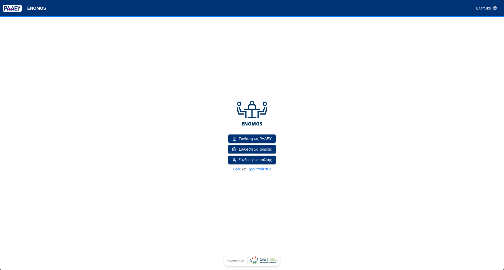
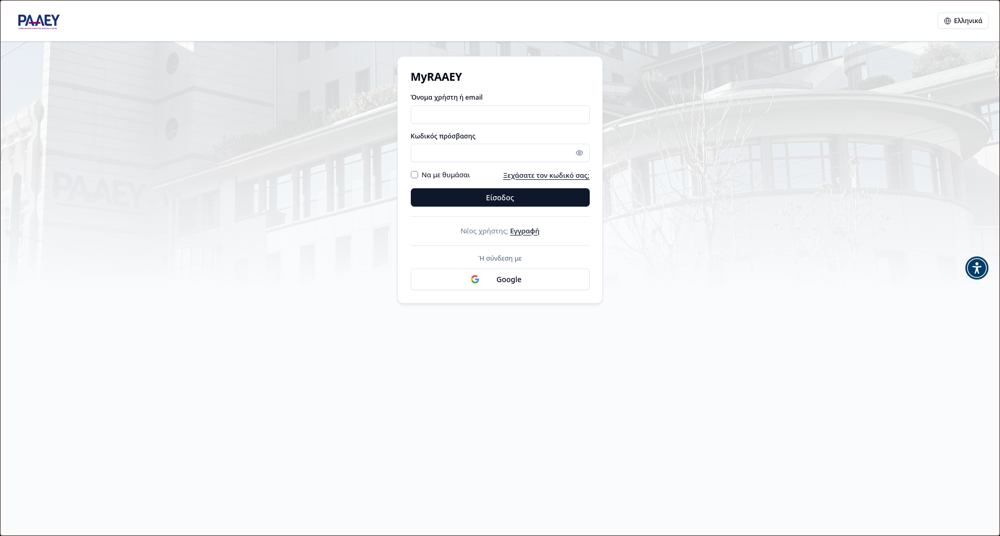
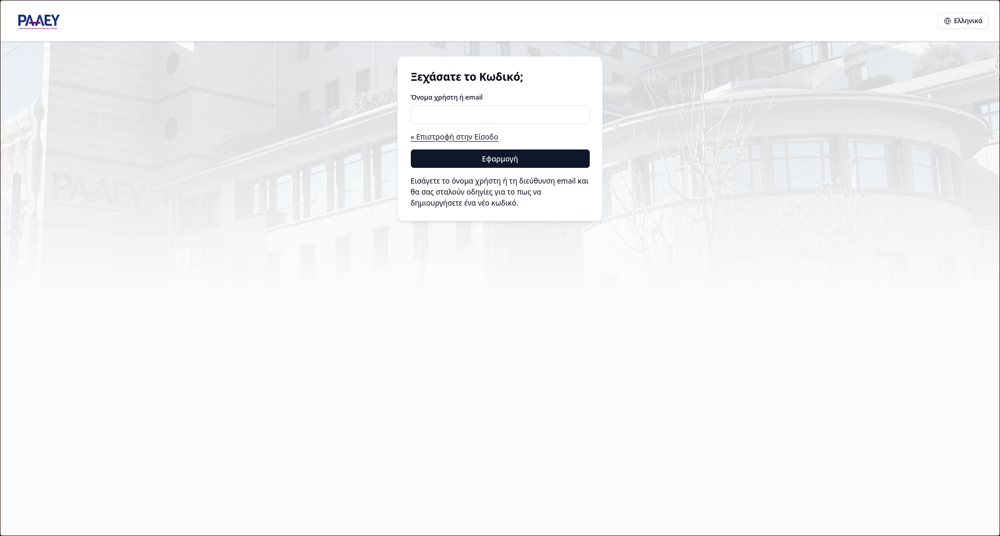

# Πρόσβαση

Για να χρησιμοποιήσετε την πλατφόρμα **Enomos** ως πολίτης, συνδέεστε με τον λογαριασμό σας στο **myraaey.gr**. Στην ενότητα αυτή περιγράφεται πώς συνδέεστε και πώς επαναφέρετε τον κωδικό σας.

!!! note

    Ο λογαριασμός σας είναι **κοινός με την πλατφόρμα [myraaey.gr](https://myraaey.gr)**. Χρησιμοποιήστε τα ίδια στοιχεία σύνδεσης και στις δύο πλατφόρμες.

## Είσοδος ως πολίτης

Από την αρχική σελίδα της πλατφόρμας, πατήστε το κουμπί **Είσοδος ως πολίτης**.

## Σύνδεση

Μεταφέρεστε στη φόρμα σύνδεσης. Από εδώ μπορείτε να:

- **συνδεθείτε** με τα στοιχεία του λογαριασμού σας στο myraaey.gr,
- **επαναφέρετε τον κωδικό σας** (βλ. [Ξέχασα τον κωδικό μου](#forgot-password)).

## Ξέχασα τον κωδικό μου { #forgot-password }

Αν δεν θυμάστε τον κωδικό σας:

1. Στη φόρμα σύνδεσης, πατήστε **Ξέχασα τον κωδικό μου**.
2. Συμπληρώστε το **email** του λογαριασμού σας.
3. Πατήστε **Εφαρμογή**.

Θα λάβετε email με οδηγίες για την επαναφορά του κωδικού σας.

