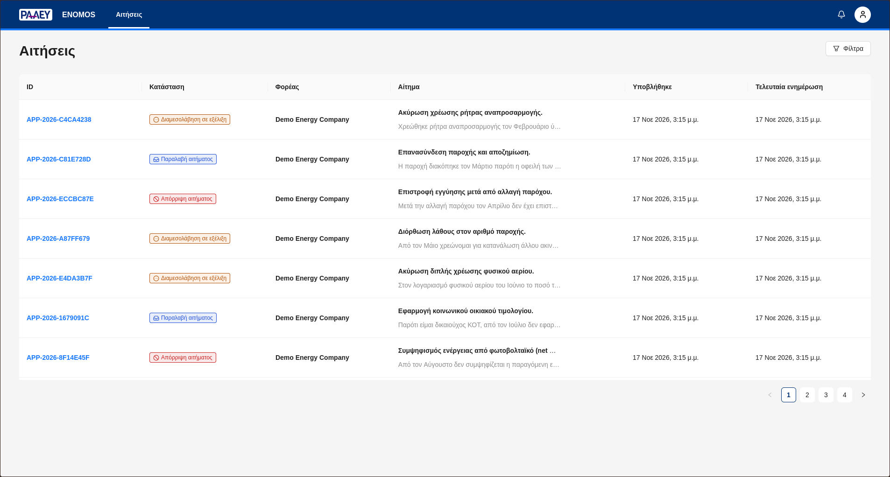
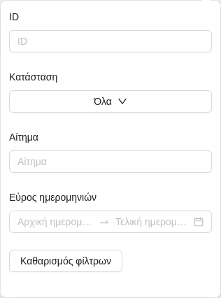
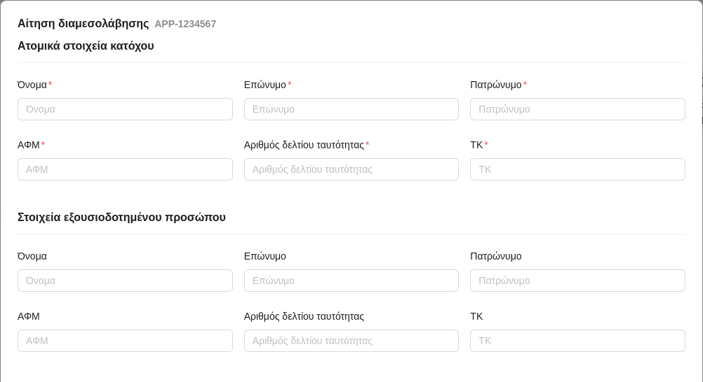
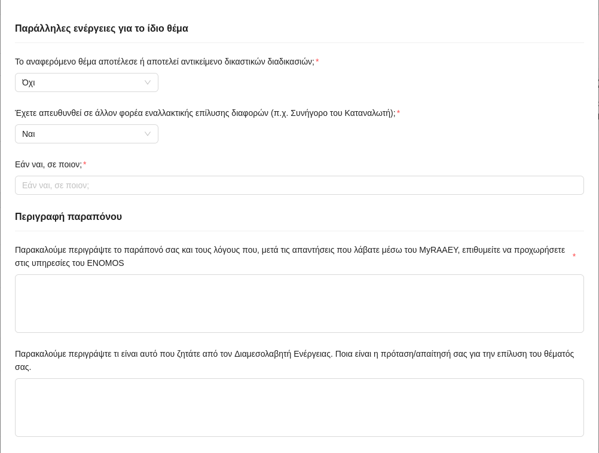
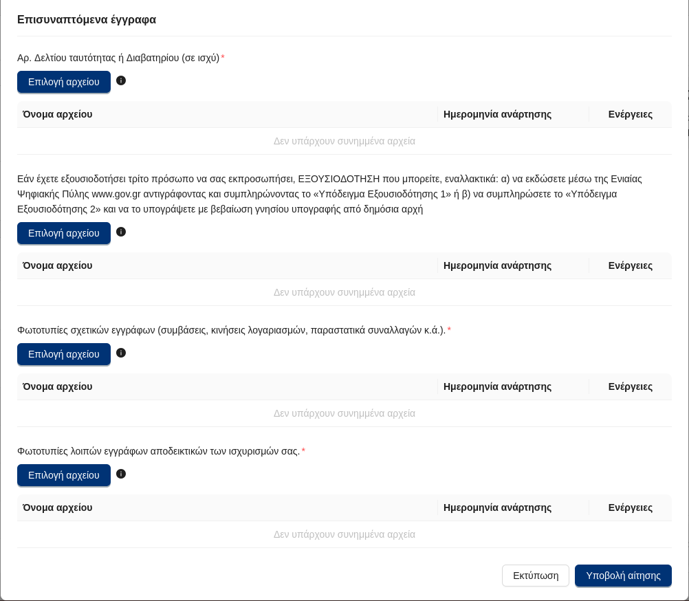
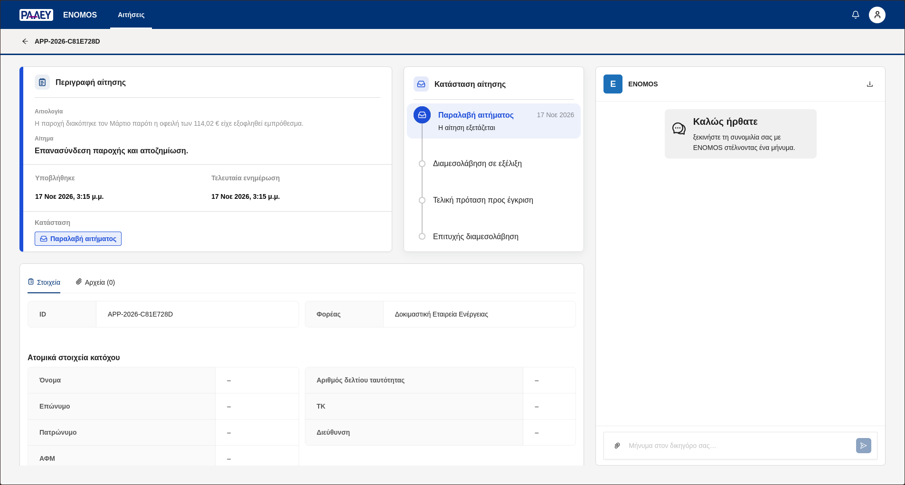
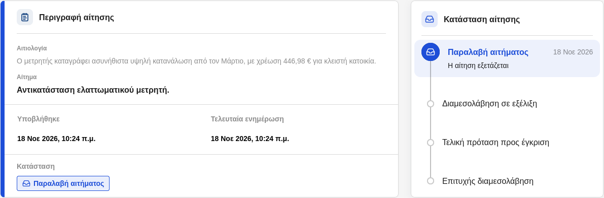
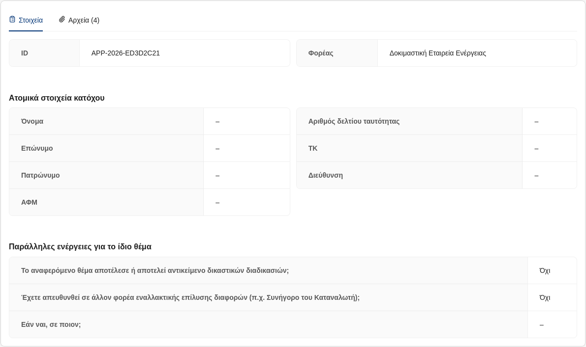
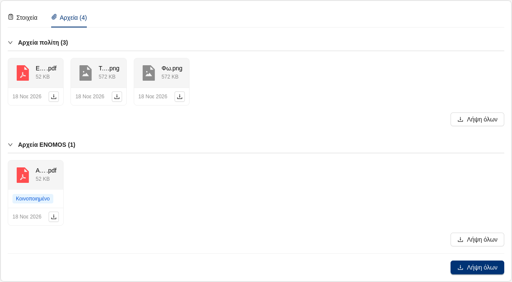
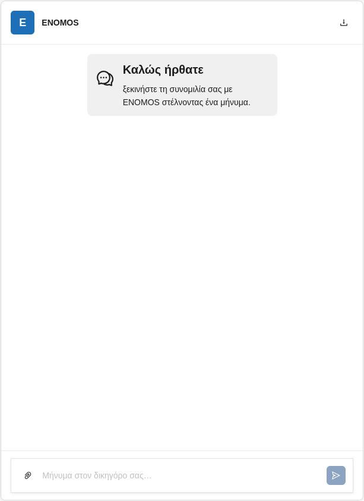

# Αιτήσεις

Η σελίδα **Αιτήσεις** συγκεντρώνει σε έναν πίνακα όλες τις αιτήσεις που έχετε υποβάλει στην πλατφόρμα **Enomos**.

## Λίστα αιτήσεων { #list }

Για κάθε αίτηση, ο πίνακας εμφανίζει τις παρακάτω πληροφορίες:

| Στήλη | Περιγραφή |
|-------|-----------|
| **ID** | Ο μοναδικός κωδικός της αίτησης. |
| **Κατάσταση** | Η τρέχουσα κατάσταση της αίτησης (βλ. [Καταστάσεις αιτήσεων](#statuses)). |
| **Φορέας** | Ο φορέας στον οποίο απευθύνεται η αίτηση. |
| **Αίτημα** | Το αντικείμενο της αίτησης. |
| **Υποβλήθηκε** | Η ημερομηνία υποβολής της αίτησης. |
| **Τελευταία ενημέρωση** | Η ημερομηνία της τελευταίας αλλαγής στην αίτηση. |

## Φίλτρα

Οι επιλογές φίλτρων βρίσκονται πάνω δεξιά από τον πίνακα. Μπορείτε να φιλτράρετε τις αιτήσεις με βάση:

- **ID**: πληκτρολογήστε τον κωδικό ή μέρος του.
- **Κατάσταση**: επιλέξτε μία ή περισσότερες [καταστάσεις](#statuses).
- **Αίτημα**: πληκτρολογήστε κείμενο που περιέχεται στο αίτημα.

## Καταστάσεις αιτήσεων { #statuses }

Μια αίτηση μπορεί να βρίσκεται σε μία από τις παρακάτω καταστάσεις:

| Κατάσταση | Περιγραφή |
|-----------|-----------|
| **Πρόχειρο** | Η αίτηση έχει δημιουργηθεί αλλά δεν έχει υποβληθεί ακόμη (βλ. [Δημιουργία αίτησης](#create)). |
| **Παραλαβή αιτήματος** | Η αίτηση έχει υποβληθεί και παραληφθεί. |
| **Διαμεσολάβηση σε εξέλιξη** | Η διαμεσολάβηση για την αίτηση βρίσκεται σε εξέλιξη. |
| **Τελική πρόταση προς έγκριση** | Έχει διαμορφωθεί τελική πρόταση και αναμένεται η έγκρισή της. |
| **Επιτυχής διαμεσολάβηση** | Η διαμεσολάβηση ολοκληρώθηκε με επιτυχία. |
| **Αποτυχημένη διαμεσολάβηση** | Η διαμεσολάβηση ολοκληρώθηκε χωρίς συμφωνία. |
| **Απόρριψη αιτήματος** | Το αίτημα απορρίφθηκε. |

## Δημιουργία αίτησης { #create }

Οι αιτήσεις ξεκινούν από την πλατφόρμα **[myraaey.gr](https://myraaey.gr)** και ολοκληρώνονται στο **Enomos**.

### Μετάβαση από το myraaey.gr

1. Στο myraaey.gr, ολοκληρώστε τη συνομιλία τριών μηνυμάτων.
2. Πατήστε το κουμπί **Μετάβαση στον Ενόμο**.

Τη στιγμή αυτή δημιουργείται η αίτηση στο Enomos σε κατάσταση **Πρόχειρο** και λαμβάνετε έναν σύνδεσμο για να τη διεκδικήσετε.

!!! note

    Μέχρι να τη διεκδικήσετε, η αίτηση δεν συνδέεται με κάποιον λογαριασμό πολίτη.

### Διεκδίκηση της αίτησης

Πατήστε τον σύνδεσμο που λάβατε. Μεταφέρεστε στην πλατφόρμα Enomos, όπου πρέπει να [συνδεθείτε](access.md). Μετά τη σύνδεση, η αίτηση συνδέεται με τον λογαριασμό σας και ανοίγει η φόρμα της αίτησης.

### Συμπλήρωση της φόρμας

#### Στοιχεία αιτούντος

Συμπληρώστε τα στοιχεία σας:

| Πεδίο | Περιγραφή |
|-------|-----------|
| **Όνομα** | Το όνομά σας. |
| **Επώνυμο** | Το επώνυμό σας. |
| **Πατρώνυμο** | Το όνομα του πατέρα σας. |
| **ΑΦΜ** | Ο Αριθμός Φορολογικού Μητρώου σας. |
| **Αριθμός δελτίου ταυτότητας** | Ο αριθμός της αστυνομικής σας ταυτότητας. |
| **Τ.Κ.** | Ο ταχυδρομικός κώδικας της διεύθυνσής σας. |

Αν η αίτηση υποβάλλεται μέσω **εξουσιοδοτημένου προσώπου**, συμπληρώστε τα ίδια στοιχεία και για εκείνο.

#### Περιγραφή της υπόθεσης

Απαντήστε στις παρακάτω ερωτήσεις:

- Αν το θέμα αποτελεί **αντικείμενο δικαστικών διαδικασιών**.
- Αν έχετε απευθυνθεί σε **άλλον φορέα εναλλακτικής επίλυσης διαφορών** (π.χ. Συνήγορο του Καταναλωτή) και, αν ναι, σε ποιον.

Στη συνέχεια, περιγράψτε γραπτώς:

- το **παράπονό** σας,
- το **αίτημά** σας προς τον διαμεσολαβητή.

#### Συνημμένα

Επισυνάψτε τα παρακάτω έγγραφα:

- Ταυτότητα ή διαβατήριο του αιτούντος.
- Ταυτότητα ή διαβατήριο του εξουσιοδοτημένου προσώπου, αν υπάρχει.
- Φωτοτυπίες σχετικών εγγράφων (συμβάσεις, κινήσεις λογαριασμών, παραστατικά συναλλαγών κ.ά.).
- Φωτοτυπίες λοιπών εγγράφων που αποδεικνύουν τους ισχυρισμούς σας.

### Υποβολή

Πατήστε **Υποβολή αίτησης** για να ολοκληρώσετε τη διαδικασία.

!!! tip

    Μπορείτε επίσης να **εκτυπώσετε** την αίτηση, να τη συμπληρώσετε και να την αποστείλετε μέσω ταχυδρομείου.

## Προβολή αίτησης { #view }

Για να δείτε μια αίτηση, πατήστε το **ID** της στον [πίνακα αιτήσεων](#list). Μεταφέρεστε στη σελίδα προβολής της αίτησης.

### Γενικά στοιχεία και στάδια

Πάνω αριστερά βρίσκεται η καρτέλα με τα **γενικά στοιχεία** της αίτησης, δηλαδή τις πληροφορίες που εμφανίζει και ο πίνακας αιτήσεων:

- **Αιτιολογία**
- **Αίτημα**
- **Υποβλήθηκε**
- **Τελευταία ενημέρωση**
- **Κατάσταση**

Δεξιά της βρίσκεται η καρτέλα με όλα τα **στάδια** της αίτησης, όπου επισημαίνεται η [κατάσταση](#statuses) στην οποία βρίσκεται αυτή τη στιγμή.

### Στοιχεία και αρχεία

Από κάτω βρίσκεται μια καρτέλα με δύο ενότητες:

=== "Στοιχεία"

    Εμφανίζονται:

    - το **ID** της αίτησης και ο **φορέας**,
    - τα ατομικά στοιχεία του κατόχου της αίτησης,
    - οι **παράλληλες ενέργειες για το ίδιο θέμα**, δηλαδή οι απαντήσεις που δώσατε στη [φόρμα της αίτησης](#create):
        - αν το θέμα αποτέλεσε ή αποτελεί αντικείμενο δικαστικών διαδικασιών,
        - αν έχετε απευθυνθεί σε άλλον φορέα εναλλακτικής επίλυσης διαφορών (π.χ. Συνήγορο του Καταναλωτή) και, αν ναι, σε ποιον.

    

=== "Αρχεία"

    Τα αρχεία που έχετε ανεβάσει εσείς και τα αρχεία που έχει διαμοιραστεί μαζί σας ο διαμεσολαβητής. Μπορείτε να **κατεβάσετε** οποιοδήποτε αρχείο.

    

### Συνομιλία με τον διαμεσολαβητή

Στο δεξί μέρος της σελίδας βρίσκεται η **συνομιλία** με τον διαμεσολαβητή. Από εδώ μπορείτε να στέλνετε μηνύματα και αρχεία.

!!! note

    Τα αρχεία που στέλνετε ή λαμβάνετε στη συνομιλία εμφανίζονται και στην ενότητα **Αρχεία**.

!!! tip

    Από το πάνω δεξί μέρος της συνομιλίας μπορείτε να **εξαγάγετε** τη συνομιλία σε υπολογιστικό φύλλο. Τα αρχεία της συνομιλίας δεν περιλαμβάνονται στην εξαγωγή.
