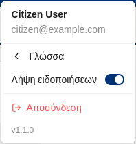

# Ρυθμίσεις

Οι ρυθμίσεις του λογαριασμού σας είναι διαθέσιμες από το **εικονίδιο χρήστη**, πάνω δεξιά στη σελίδα.

## Μενού χρήστη

Πατώντας το εικονίδιο χρήστη εμφανίζεται ένα μενού με τις παρακάτω επιλογές:

| Επιλογή | Περιγραφή |
|---------|-----------|
| **Ονοματεπώνυμο και email** | Τα στοιχεία του λογαριασμού με τον οποίο είστε συνδεδεμένοι. |
| **Γλώσσα** | Αλλάζει τη γλώσσα της πλατφόρμας. |
| **Λήψη ειδοποιήσεων** | Ενεργοποιεί ή απενεργοποιεί όλες τις [ειδοποιήσεις](#notifications). |
| **Αποσύνδεση** | Αποσυνδέεστε από την πλατφόρμα. |

## Ειδοποιήσεις { #notifications }

Η πλατφόρμα σάς ενημερώνει για αλλαγές στις αιτήσεις σας με δύο τρόπους:

- **Στην εφαρμογή**: η ειδοποίηση εμφανίζεται άμεσα στη λίστα ειδοποιήσεων της πλατφόρμας.
- **Με email**: η ειδοποίηση αποστέλλεται στη διεύθυνση email του λογαριασμού σας.

| Ειδοποίηση | Πότε τη λαμβάνετε | Στην εφαρμογή | Email |
|------------|-------------------|:-------------:|:-----:|
| **Αλλαγή κατάστασης αίτησης** | Όταν αλλάζει η [κατάσταση](applications.md#statuses) μιας αίτησής σας. | ✓ | ✓ |
| **Νέο μήνυμα** | Όταν λαμβάνετε μήνυμα στη [συνομιλία](applications.md#view) με τον διαμεσολαβητή. | ✓ | – |
| **Μη αναγνωσμένα μηνύματα** | Μία φορά την ημέρα, αν έχετε μηνύματα που δεν έχετε διαβάσει. | – | ✓ |
| **Η εξαγωγή συνομιλίας είναι έτοιμη** | Όταν ολοκληρωθεί η [εξαγωγή μιας συνομιλίας](applications.md#view) που ζητήσατε. | ✓ | ✓ |

!!! note

    Οι ειδοποιήσεις αποστέλλονται **μόνο όταν η επιλογή Λήψη ειδοποιήσεων είναι ενεργή**. Αν την απενεργοποιήσετε, δεν λαμβάνετε καμία από τις παραπάνω ειδοποιήσεις, ούτε στην εφαρμογή ούτε με email.
